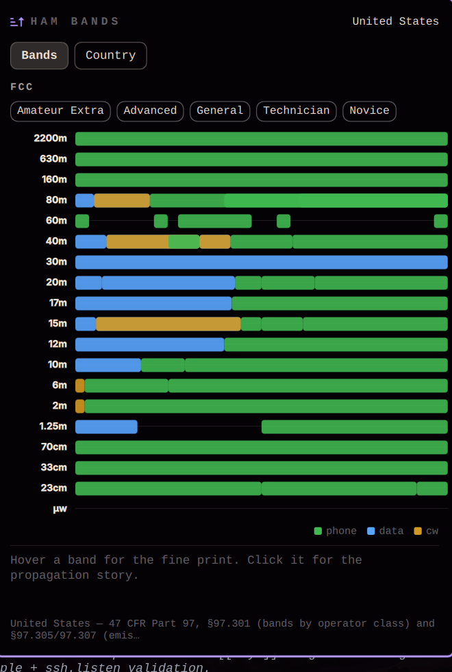

# Ham Bands — Omarchy bar plugin



Amateur radio frequency allocations by country and license class, in the
[Omarchy](https://omarchy.org) (Quattro) bar. Pick your country and your
license, and see exactly where you may transmit — every band drawn at its real
place, with the segments the regulator gives your class lit up and the rest
dimmed rather than hidden.

No API key, no account, no network at all: the tables are curated into the
plugin from national regulator documents and checked by a test suite.

## The popup

- **Bands** — the allocation chart for the chosen country. A true-scale
  log overview (100 kHz – 300 GHz) shows every allocation at its real
  place, then per-band detail rows show each band at full width with its
  true range printed at right. Every segment is coloured by mode (phone,
  data, CW). Tapping a class chip (e.g. *Foundation*, *General*,
  *Klasse E*) filters the view to your privileges — segments you may
  use stay lit, the rest ghost out but remain visible, because knowing
  what is *around* your license is half the point of a chart like this.
  Hover any stretch for the fine print (range, classes, modes, power);
  click any band for its propagation story and segment table.
- **Country** — a searchable picker across every country in the dataset.
  The choice lasts until restart; the tab shows the `omarchy bar set`
  commands that make it permanent.

## The dataset

`allocations.js` (with `bands.js`, the pure-JS rules over it) ships one entry
per contiguous frequency segment on which the permitted classes and the mode
list are uniform — kHz, inclusive bounds. Where two segments share a range
with different mode lists, their class sets are disjoint; the tests enforce
this, along with tiling, class declaration, and regulator citation for every
country.

Fifteen countries ship in v0.1, each grounded in its regulator's document
(every country names its source and when it was last checked against it):

| Country | Regulator · document | Classes modelled |
|---|---|---|
| United States | FCC · 47 CFR Part 97, §97.301/97.305/97.307 (eCFR XML) | Extra, Advanced, General, Technician, Novice |
| Canada | ISED · RBR-4 Issue 3 (2022) Schedule I | Advanced, Basic with Honours, Basic |
| United Kingdom | Ofcom · OFW611 (Feb 2024), Schedule 1 Tables A/B/C; RSGB cross-check | Full, Intermediate, Foundation |
| Germany | BNetzA · AFuV Anlage 1 (2024) | Klasse A, E, N |
| Australia | ACMA · Amateur Stations Class Licence 2023, Schedule 2 | Advanced, Standard, Foundation |
| Japan | MIC · 電波法施行令 Art. 3(3) (e-Gov XML); JARL band plan | 1st–4th class |
| Netherlands | RDI · Regeling gebruik frequentieruimte 2015, Bijlage 1 | F, N |
| Italy | MIMIT · PNRF (DM 5 Oct 2018); classe N per DM 26 Jan 2026 | A, N (N pending its decree — no segments yet) |
| India | WPC · Office Memorandum L-14011/255/2004-AMT Annexure-I | General, Restricted |
| South Africa | ICASA · Radio Frequency Spectrum Regulations 2015, s23 + Annex I | A, B |
| Brazil | ANATEL · Ato 926/2024 Tabela I (+Ato 3.448/2026) | A, B, C |
| France, Spain, Sweden | ANFR TNRBF / CNAF (Orden TDF/732/2026) / PTSFS 2022:19 | single HAREC class |
| New Zealand | RSM · GURL for Amateur Radio Operators (2025) | General Amateur Operator |

Where a regulator's table could not be fetched directly (bot-blocking,
PDF-only), the national society's chart was used as the working source and the
country note says so; unverifiable band edges carry an `unverified` note
rather than a confident wrong number. Known simplifications are disclosed in
the country notes (e.g. Japan: the MIC band-plan notice further segments
modes per grade — not transcribed; Brazil: per-sub-band mode tables omitted).

## Adding a country or fixing a table

Country files live in `data/<ISO>.json`:

```json
{
  "id": "XX", "name": "Country", "ituRegion": 1,
  "regulator": { "name": "...", "document": "...", "url": "https://...", "retrieved": "2026-09" },
  "source": { "id": "...", "name": "...", "url": "https://...", "retrieved": "2026-09" },
  "classes": [ { "id": "full", "name": "Full / HAREC" } ],
  "note": "how class gating works; key deviations; which source was ground truth",
  "bands": [
    { "band": "80m", "from": 3500, "to": 3600, "classes": ["full"], "modes": ["cw","data","phone","image"], "note": "power caps, geographic limits, channelisation" }
  ]
}
```

kHz, inclusive bounds; two segments may share a range only with disjoint
class sets. Then:

```bash
node tools/merge-data.mjs       # fold data/*.json into allocations.js
node tools/test-bands.mjs       # integrity checks must pass
```

## What is checked

`tools/test-bands.mjs` runs the same `bands.js` Quickshell runs and checks the
dataset against itself and the regulator documents: spectrum-order tiling, no
overlapping ranges within a shared class, every segment's classes declared,
every class used (or documented pending, as Italy's classe N legitimately is),
regulator citation with https URL and retrieval stamp, and FCC landmarks —
Technician at 3525 kHz, Extra at 3500, nothing below 135.7, and 700.5 MHz
being nobody's band.

```bash
node tools/test-bands.mjs
```

## Requirements

- Omarchy **Quattro (v4)** with `omarchy-shell` (Quickshell-based bar)
- A Nerd Font in the bar (Omarchy ships one) for the glyph

## Install

```bash
omarchy plugin add https://github.com/crueber/omarchy-hambands.git --enable
omarchy bar move crueber.hambands right
```

## Uninstall

```bash
omarchy plugin disable crueber.hambands
omarchy plugin remove crueber.hambands
omarchy restart shell
```

## Settings

Omarchy has no settings UI for bar widgets yet — the manifest declares a
schema for the one that is coming. Until then:

```bash
omarchy bar set crueber.hambands country DE
omarchy bar set crueber.hambands myClass e
omarchy restart shell
```

| Setting | Key | Does |
|---|---|---|
| Country | `country` | ISO 3166-1 alpha-2 code, e.g. `US`, `GB`, `DE`, `AU`. Blank means US |
| Your license class | `myClass` | Class id from the country's table, e.g. `technician`, `foundation`, `e`. Blank shows every class |
| Bar pill shows | (fixed) | Transceiver glyph |
| Popup position | `popupPosition` | `icon` or `center` |

## Developing locally

```bash
./deploy-local.sh          # symlink into ~/.config/omarchy/plugins and validate
omarchy plugin enable crueber.hambands right
omarchy restart shell      # reload after each edit
```

## Data and disclaimer

Curated from national regulator documents; see the table above and each
country's `regulator` entry for the primary source and retrieval date. Rules
change — check your regulator's current text before you transmit. Nothing
here is legal advice or a substitute for your licence document.

## License

MIT. Not affiliated with or endorsed by any regulator or national society.
